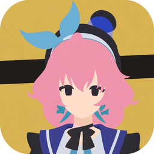

# Controller Bagbuddy



界面默认中文。软件左侧点 **中文 / English** 可切换界面语言。

英文说明在文末折叠区，点开即可在本页阅读，不用跳到别的文件。

根据截图划分背包格子，热键极快滑动鼠标定位。Windows / Python。

## 项目简介

在背包、仓库、商店这类格子界面上截一张图，把大区框出来，填上列和行。激活之后，方向热键会把鼠标滑到相邻格子上，用来对准，不代替你点击。

坐标按「截图左上角 = 屏幕左上角」换算。全屏或无边框、截图和目标分辨率一致时最准。程序只动光标，不读物品、不注入游戏。

## 功能特性

- [x] 打开截图或从剪贴板粘贴，拖拽划分大区
- [x] 按列、行自动算格子；落点可选格子中心或左上角
- [x] 多套界面（背包 / 仓库 / 商店），各自分辨率和切换热键
- [x] 大区按中心位置双向链接，走到边缘可以跨区
- [x] 特征点识色，屏幕上的界面变了就自动切布局
- [x] 热键移鼠：短距离多步滑动，最后校正落点
- [x] 全屏辅助线，当前区绿色、其它区白色，点击穿透
- [x] 多份配置，不同游戏分开存
- [x] 中英文界面切换；语言保存在 `ui_lang.json`（默认中文）

## 环境要求

- Windows 10/11。全局热键和移鼠只在 Windows 上可用
- 管理员权限。启动时如果还不是管理员，会弹 UAC 再拉起自己；点取消就退出
- 源码运行：Python 3.9+，[Pillow](https://pypi.org/project/Pillow/)
- 打包： [PyInstaller](https://pyinstaller.org/)

非 Windows 可以打开界面改框和配置，热键移鼠不可用。

## 快速开始

1. 打开 [Releases](https://github.com/giantstriker/Controller-Bagbuddy/releases)，下载最新的 `Controller-Bagbuddy-*-win64.zip`，解压出 `Controller-Bagbuddy.exe`。
2. 运行 EXE，通过 UAC（全局热键需要管理员权限）。
3. **打开截图** 或 **粘贴截图**。尽量截整屏，和游戏分辨率一致。
4. 在画布空白处拖出一个大区，填 **列**、**行**。
5. 底栏把分辨率设成游戏分辨率，或点 **用截图尺寸**。
6. 底栏点 **激活** 旁边的按键块，按下一个不跟游戏冲突的键。方向键默认已是 ←→↑↓。
7. 点底栏 **激活**（或按刚绑的键），再用方向键把鼠标滑到格子上。

要从源码跑或自己打包，见文末「源码运行」和「打包」。

## 使用说明

### 划格子

1. **打开截图** 选文件，或 **粘贴截图** 读剪贴板。换图后以新图为准。
2. 空白处拖拽拉出新大区，也可以点 **新增大区**。拖内部移动，拖四角缩放。
3. 微调（未激活、且没锁时才生效）：
   - `Ctrl` + ← / ↑：右边缘或下边缘收 1 像素；`Ctrl` + → / ↓：放出 1 像素
   - 加上 `Shift`：一次 10 像素
   - `[` `]`：四边同时缩/放 2 像素
   - `{` `}`：四边同时缩/放 10 像素
4. 改 **列** / **行** 后，格子宽高按「区域宽 ÷ 列、区域高 ÷ 行」重填。
5. **格子中心**（默认）落在格心；**左上角** 落在格的左上角。差半格时先看这个。
6. 已经知道单格像素时，填好宽高，点 **按格子尺寸重算大区**，框会按「宽 × 列、高 × 行」从左上角撑开。

运行时的屏幕坐标：

```text
屏幕 x = 图像 x × (目标宽 / 截图像素宽)
屏幕 y = 图像 y × (目标高 / 截图像素高)
```

每个界面有自己的目标宽高。窗口不在屏幕左上角时，请截整屏，不要只截窗口，否则落点会偏。

### 多界面

背包、仓库、商店分成不同界面，分辨率和特征点互不影响。

- **新增界面** / **复制** / **删除**。至少留一个。复制会带上大区和特征点，切换热键是空的。
- 单击一行切换；右键 **重命名界面**。
- 行右侧按键块是「切到这个界面」的专属键。点一下，再按键。`Esc` 或右键取消，`Backspace` / `Delete` 清空。
- 底栏 **上一界面** / **下一界面** 在列表里循环。

### 跨区域链接

一个界面里可以有多块格子区（主背包、快捷栏、旁边的材料栏）。

1. 在大区上右键 → **链接区域…**，选另一块。至少要有两个大区。
2. 方向按两块的 **中心** 比较：水平差更大就算左右，垂直差更大就算上下，并写成双向链接。同一方向原来的链接会被盖掉。
3. 链接成功会自动勾上 **跨区域移动**。
4. 大区列表上能看到 `←1` `→2` 这类标记，数字是对方在列表里的序号（从 1 计）。
5. **清除本区链接** 会把本区四个方向清掉，对方指回来的也一起清。

走到边缘时：

| 跨区域移动 | 该方向有链接 | 结果 |
|------------|--------------|------|
| 开 | 有 | 进入邻区，并落到同行或同列的边上那一格 |
| 开 | 没有 | 停在边缘，不环绕 |
| 关 | — | 只在本区内环绕 |

### 特征点识色

用来识别「现在屏幕上是哪一套界面」，命中后自动切换，不用手按切换键。程序启动后就会采样，不必先激活移鼠。

1. 先载入和实机一致的截图。
2. 点该界面右侧的 **色**（已设置时按钮是绿的）。
3. **开始点选**，在右侧画布上点稳定的像素：标题栏、固定图标、不会随物品变色的底。`Esc` 或再点一次按钮停止。
4. 颜色容差默认 ±15，界面上建议 12～18。点 **保存并开启** 时，当前容差会写到本界面全部点上，并立刻存盘。
5. 右键 **色** 清空该界面的点，识色关闭。

每个点记下图像坐标和 RGB。运行时约每 0.4 秒按该界面的分辨率映射到屏幕取样（`GetPixel`）。**全部** 点都在容差内才算命中。多个界面同时命中时保持当前界面；真正切过去之后有约 1 秒冷却，避免来回跳。`feature_points` 为空就是关。

点纯白、纯黑这种到处都有的颜色，很容易误切。同一界面多点几个位置更稳。

### 移鼠

1. 底栏点按键块再按键完成绑定。`Esc` / 右键取消，`Backspace` / `Delete` 清空。单独的 Shift、Ctrl、Alt 不会被录进去。
2. **激活** 默认是空的，需要自己绑。方向键默认：←→↑↓ 移动一格，`PageUp` / `PageDown` 切换上一个 / 下一个大区。
3. 点底栏 **激活**，或按激活热键。
   - 激活时自动打开 **全局锁定**，避免框被拖走。关掉激活不会自动解锁，要改框就再点一次左侧的全局锁定。
   - 勾了 **同时绘制界面边框** 时，会铺全屏辅助线；再关激活，辅助线一起关。
4. 只有激活之后，格子方向键才会动鼠标。长按会连跳。
5. 移动方式：`SendInput` 做多步相对位移（近处约 8 步，远处约 26 步），最后 `SetCursorPos` 对齐。总时长大约十几毫秒，看起来是很快划过去，不是瞬间瞬移。激活期间进程优先级会调高，关掉后恢复。

底栏能绑的动作：

| 底栏名称 | 作用 | 默认 |
|----------|------|------|
| 激活 | 开/关移鼠 | 空 |
| 辅助线 | 开/关全屏格子线 | 空 |
| 全局锁 | 开/关全部大区锁定 | 空 |
| 上个区域 / 下个区域 | 换当前界面里的大区，并滑到该区当前格 | PageUp / PageDown |
| 朝左/右/上/下一格 | 滑到相邻格 | ← → ↑ ↓ |
| 上一界面 / 下一界面 | 循环切换界面 | 空 |

`cell_home`（回到当前区第 1 格）、`cell_again`（再滑到当前格）写在配置 JSON 里，底栏没有入口。源码里的快捷键设置窗口当前也没有按钮打开，改键以底栏和 JSON 为准。

辅助线是全屏置顶的格子线：当前区 `#00e676`，其它区白色。Windows 下点击穿透，一般不会挡住游戏操作。

## 界面说明

### 左侧

- **打开截图** / **粘贴截图**。旁侧 **中文 / English** 可切换界面语言
- **全局锁定**：锁住全部大区。激活移鼠时会自动勾上，关掉激活后仍然勾着
- **屏幕辅助线**：手动开关全屏格子线
- **背包界面 / 层级**：列表、新增、复制、删除、界面名。每行右侧是专属切换键和 **色**
- **当前界面的大区**：列表、新增、复制、删除、大区名、列、行、格子宽高、原点、按格子尺寸重算。每行右侧 **锁定** 只锁这一块；全局锁定开着时这个勾选不可用
- **跨区域移动**：跨区总开关。文案写的就是：开则有链接跨区、无链接卡边缘；关则环绕
- **保存** / **复制JSON** / **导出**
- **配置文件（多游戏）**：下拉选择，**切换配置**、**新建**、**另存为**、**删除**
- 下面两行绿字 / 灰字是当前格子信息和状态

左侧面板比窗口高时可以滚轮滚动。鼠标停在界面列表或大区列表上时，滚的是那一栏。

### 画布

深色背景。当前大区绿框，其它大区白框，格子点按列×行和格子尺寸画出来。大区之间的链接会画箭头。

正在点选特征点时，单击画布是加采样点，不再拖框。

### 底栏

从左到右：

- **激活** 大按钮，以及 **同时绘制界面边框**
- **分辨率** 预设（640p 到 4K、两种超宽，对不上就是「自定义」）、宽、高、**用截图尺寸**
- **快捷键**：两行按键块，点名字右边的键再按键盘

分辨率存在当前界面上，换界面会换成那一套的宽高。

## 界面语言（中 / EN）

- 左侧 **打开截图** / **粘贴截图** 旁有 **中文 / English** 按钮，点击在中文与英文界面之间切换。
- 选择会立即刷新按钮、列表、热键栏、对话框等可见文案；窗口标题仍为 **Controller Bagbuddy**。
- 语言保存在程序目录下的 `ui_lang.json`（与 EXE / `code.py` 同级），内容形如 `{"lang": "zh"}` 或 `{"lang": "en"}`。
- **默认中文**（`zh`）：文件不存在或内容非法时按中文启动。
- 配置文件、热键绑定、布局数据不受语言切换影响。

## 配置说明

一套配置一个文件：`configs/<名字>.json`。当前用哪一套写在 `active_config.json`：

```json
{ "active": "2" }
```

仓库里带了两份样例：`configs/2.json` 是单区空配置，`configs/default.json` 里有跨区链接和特征点。现在生效的是 `2`。

左侧操作：

- **保存**：写入当前这份，并记到 `active_config.json`。同时会在程序目录写一份 `hotkeys.json`，给旧版本兼容，仓库不用提交它
- **复制JSON**：整份配置进剪贴板
- **导出**：另存到任意路径，不切换当前配置
- **切换配置**：下拉选好再点；如果下拉里还是当前这份，会再问一次名字。切换前可以选择是否保存
- **新建**：一份默认背包（1920×1080、一个 10×5 的默认大区、默认热键）
- **另存为**：把当前内容存成新名字并切过去。同名会问是否覆盖
- **删除**：至少留一份。删掉当前这份后会切到剩下的第一份

退出窗口时会自动保存当前配置。

名字里的 `\ / : * ? " < > |` 会被换成下划线。

只有 `configs/` 里一个 json 都没有时，才会把旧的根目录 `layouts.json` / `hotkeys.json` 迁进 `configs/default.json`。目录里已经有文件时不会动旧文件。

结构：

```json
{
  "layouts": [
    {
      "name": "背包",
      "switch_key": "d",
      "res_w": "1920",
      "res_h": "1080",
      "feature_points": [
        { "x": 884.23, "y": 333.14, "r": 248, "g": 248, "b": 248, "tol": 15 }
      ],
      "regions": [
        {
          "name": "区域1",
          "rx1": 40, "ry1": 40, "rx2": 440, "ry2": 280,
          "cols": 10, "rows": 5,
          "cell_w": "40", "cell_h": "48",
          "origin": "center",
          "locked": false,
          "link_left": null, "link_right": 1,
          "link_up": null, "link_down": null
        }
      ]
    }
  ],
  "hotkeys": {
    "cell_left": "left",
    "cell_right": "right",
    "cell_up": "up",
    "cell_down": "down",
    "prev_region": "prior",
    "next_region": "next",
    "toggle_mouse": "",
    "prev_layout": "",
    "next_layout": "",
    "cell_home": "",
    "cell_again": "",
    "toggle_overlay": "",
    "toggle_global_lock": ""
  },
  "cross_region": false
}
```

| 字段 | 含义 |
|------|------|
| `switch_key` | 切到该界面的键，空字符串表示没绑 |
| `res_w` / `res_h` | 该界面的目标分辨率，字符串 |
| `rx1,ry1,rx2,ry2` | 大区在截图上的像素框 |
| `origin` | `center` 或 `topleft` |
| `link_*` | 同一界面里目标大区的下标，从 0 计；`null` 为无 |
| `feature_points[].tol` | 单通道容差，0–255 |
| `hotkeys` 的值 | Tk 键名小写：`left`、`prior`（PageUp）、`next`（PageDown）、`f10`、`a` |
| `cross_region` | 跨区域移动总开关 |

旧字段 `region_left` / `region_right` / `region_up` / `region_down` 读进来后会被清掉，不再参与移鼠。

## 源码运行

```bat
pip install pillow
python code.py
```

同样需要通过 UAC。日常使用优先下 Releases 里的 EXE。

## 打包

在源码目录执行：

```bat
pyinstaller --noconfirm --clean --onefile --windowed --uac-admin ^
  --name "Controller Bagbuddy" --icon backpack_tool.ico ^
  --distpath . --workpath build_tmp --specpath build_tmp code.py
```

成功后可以删掉 `build_tmp`。正在运行的提权进程会占着 EXE，先退出再打包。如果写不进去，可能生成 `*_更新.exe`，退出程序后再替换。

EXE、`*_更新.exe`、`build_tmp/`、`*.spec` 都在 `.gitignore` 里，不要提交。

## 目录结构

| 路径 | 作用 |
|------|------|
| `code.py` | 源码 |
| `backpack_tool.ico` | 窗口和 EXE 图标 |
| `bagbuddy-icon-256.png` | 文档顶部用的标志 |
| `bagbuddy-icon-512.png` | 更大一档的标志 |
| `configs/default.json` | 样例：多区、链接、特征点 |
| `configs/2.json` | 样例：单个大区 |
| `active_config.json` | 当前配置名 |
| `ui_lang.json` | 界面语言（`zh` / `en`），默认中文；生成在 EXE / `code.py` 同级目录 |
| `README.md` | 项目说明（中文正文；English 在同页折叠展开） |
| `.gitignore` | 缓存、虚拟环境、打包产物 |

## 常见问题

**点了 UAC 取消，窗口闪一下没了。**  
全局热键需要管理员。重新打开并允许提权。

**热键没反应。**  
确认是提权后的那个进程。底栏如果停在「按键…」，先 `Esc` 退出录键。修饰键本身不能当热键。和游戏用了同一个键就改绑，比如小键盘或 `F10`。

**激活了，鼠标不动，或飞到屏幕外面。**  
先看大区的列、行是不是 0。再对一下目标分辨率和截图尺寸：只截了窗口、或者游戏不在屏幕左上角，都会偏。落点差大约半格时，把原点在 **格子中心** 和 **左上角** 之间换一下。

**第二次载入的还是旧图。**  
用本仓库的 `code.py`。也可以重新截一张，用 **粘贴截图**。

**辅助线挡住操作。**  
Windows 下辅助线是点击穿透的。不想看就取消 **同时绘制界面边框**，或关掉 **屏幕辅助线**。

**走到边缘不进旁边的区。**  
右键 **链接区域…**。看列表上的箭头是不是指到你要的那块——方向按中心位置算，不按你命名的上下左右。**跨区域移动** 要勾着；关掉之后只会在本区里绕圈。

**识色不切换，或者两个界面来回跳。**  
点要落在不随物品变化的地方，几个点必须同时对上。容差先用 12～18。该界面的 `res_w` / `res_h` 要和实机一致，否则取样点会错位。颜色太常见就多加几个点，或者换更有区分度的位置。切换后约 1 秒内不会再切。

**框拖不动，方向键微调也没反应。**  
全局锁定或这一区的 **锁定** 开着。激活移鼠时会自动打开全局锁定，关掉激活之后锁还在，需要再点左侧 **全局锁定** 取消。

**打包时 EXE 覆盖失败。**  
先退出已经提权的程序。出现 `*_更新.exe` 就等进程结束后再换成正式文件名。

**换了一版，配置找不着。**  
看程序所在目录的 `configs/` 和 `active_config.json`，不是看仓库里的样例。只有配置目录是空的，才会自动迁入旧的 `layouts.json`。

## 许可证

仓库里没有 LICENSE 文件，也没有选定开源协议。代码按本地工具公开在这里，使用和再分发前请自己判断；拿去对游戏用时，遵守那个游戏的用户协议。

---

<details>
<summary><strong>English</strong></summary>


Map inventory cells from a screenshot, then glide the cursor onto them with hotkeys. Windows / Python.

## Overview

Screenshot a bag, stash, or shop grid, draw the regions, and set columns and rows. After you activate, arrow hotkeys slide the mouse onto the next cell so you can aim. The app does not click for you.

Screen position is `image pixel × (target resolution / image size)`, with the screenshot’s top-left treated as the screen’s top-left. Fullscreen or borderless, with the screenshot taken at the same resolution as the game, is the case that lands correctly. The program only moves the cursor. It does not read items or inject into the game.

## Features

- [x] Open a screenshot or paste one, then drag out regions
- [x] Cell size from columns and rows; aim at cell center or top-left
- [x] Several layouts (bag / stash / shop), each with its own resolution and switch key
- [x] Bidirectional links between regions, chosen from their centers, so a step off the edge can cross
- [x] Color probes that switch layout when the live UI matches
- [x] Hotkey mouse glide: a short multi-step slide, then a position correction
- [x] Full-screen grid overlay, green for the active region, white for the others, click-through
- [x] Named profiles so each game keeps its own file
- [x] Chinese / English UI toggle; language saved in `ui_lang.json` (default Chinese)

## Requirements

- Windows 10/11. Global hotkeys and cursor motion work on Windows only
- Administrator. If the process is not elevated, it relaunches itself with UAC and exits when you cancel
- From source: Python 3.9+ and [Pillow](https://pypi.org/project/Pillow/)
- To build an EXE: [PyInstaller](https://pyinstaller.org/)

On other platforms the editor still opens, but hotkeys and cursor motion do not.

## Quick start

1. Open [Releases](https://github.com/giantstriker/Controller-Bagbuddy/releases), download the latest `Controller-Bagbuddy-*-win64.zip`, and extract `Controller-Bagbuddy.exe`.
2. Run the EXE and accept UAC (admin is required for global hotkeys).
3. **Open screenshot** or **Paste screenshot**. A full-screen capture at the game’s resolution is the one to use.
4. Drag a region on the empty canvas and set **columns** and **rows**.
5. Set the bottom-bar resolution to the game, or click **Use screenshot size**.
6. Click the key chip next to **Activate** and press a key that does not fight the game. The arrow keys are already bound to cell steps.
7. Press **Activate**, then use the arrow hotkeys to glide onto cells.

To run from source or build your own EXE, see **Run from source** and **Build** below.

## Usage

### Drawing the grid

1. **Open screenshot** loads a file. **Paste screenshot** reads the clipboard. A new image replaces the previous one.
2. Drag on empty canvas to create a region, or click **Add region**. Drag inside a region to move it; drag a corner to resize.
3. Nudges apply only while mouse mode is off and the region is unlocked:
   - `Ctrl` + Left / Up: pull the right or bottom edge in by 1 px; `Ctrl` + Right / Down: push it out by 1 px
   - Add `Shift`: 10 px
   - `[` `]`: shrink or grow all four sides by 2 px
   - `{` `}`: 10 px
4. Changing **columns** / **rows** refills cell width and height as `region size ÷ count`.
5. **Cell center** (default) aims at the middle of the cell. **Top-left** aims at the cell’s top-left corner. A miss of about half a cell is usually this setting.
6. If you already know the cell size in pixels, fill width and height and click **Rebuild region from cell size**. The box grows from its top-left by `width × columns` and `height × rows`.

Runtime mapping:

```text
screen x = image x × (target width / image width)
screen y = image y × (target height / image height)
```

Each layout stores its own target size. If the game window is not at the screen origin, capture the whole screen rather than the window alone, or the cursor will be offset.

### Layouts

Split bag, stash, and shop into separate layouts. Resolution and color probes belong to that layout.

- **Add layout** / **Copy** / **Delete**. One layout must remain. Copy keeps regions and probes; the switch key starts empty.
- Click a row to select it. Right-click → **Rename layout**.
- The key chip on the row is the dedicated “switch to this layout” key. Click it, then press a key. `Esc` or right-click cancels. `Backspace` / `Delete` clears it.
- Bottom-bar **Previous layout** / **Next layout** cycle the list.

### Cross-region links

One layout can hold several grids (main bag, hotbar, a side panel).

1. Right-click a region → **Link region…** and pick another. You need at least two regions.
2. The axis comes from the two **centers**: the larger of horizontal and vertical distance becomes left/right or up/down, and the link is written both ways. An existing link on that side is replaced.
3. Creating a link turns **Cross-region move** on.
4. The region list shows marks such as `←1` `→2`. The number is the other region’s 1-based index.
5. **Clear links** drops this region’s four sides and the reverse links that pointed back at it.

At the edge of a region:

| Cross-region move | Link on that side | Result |
|-------------------|-------------------|--------|
| On | Yes | Enter the neighbor, on the same row or column, at the edge cell |
| On | No | Stay on the edge. No wrap |
| Off | — | Wrap inside this region only |

### Color probes

Probes answer “which layout is on screen?” and switch automatically. Sampling starts with the process; you do not have to activate mouse mode first.

1. Load a screenshot that matches the live UI.
2. Click **色** on that layout’s row (the button turns green once probes exist).
3. **Start picking**, then click stable pixels on the canvas: a title bar, a fixed icon, a background that does not change with the item. `Esc` or the button again stops picking.
4. Tolerance defaults to ±15. 12–18 is the range the dialog suggests. **Save & enable** writes the current tolerance onto every probe of this layout and saves immediately.
5. Right-click **色** to clear the probes and turn detection off for that layout.

Each probe stores image `(x, y)` and RGB. About every 0.4s the app maps those points through the layout’s resolution and samples the screen (`GetPixel`). **All** probes must fall inside tolerance. If several layouts match, the current one stays. After a real switch there is about a 1 second cooldown. An empty `feature_points` list means off.

Plain white or plain black matches too often. Several distinctive points on the same layout are steadier.

### Mouse glide

1. Click a bottom-bar chip, then press the key. `Esc` / right-click cancels. `Backspace` / `Delete` clears. Shift, Ctrl, and Alt alone are ignored.
2. **Activate** starts unbound. Arrows move one cell. `PageUp` / `PageDown` select the previous / next region.
3. Click **Activate**, or press its hotkey.
   - Activation turns **global lock** on so the boxes are not dragged by accident. Turning activation off does not clear the lock; uncheck **Global lock** on the left before editing.
   - If **Draw layout borders** is checked, the full-screen overlay appears, and it hides again when you deactivate.
4. Cell hotkeys move the cursor only while activated. Holding a key repeats.
5. Motion is a series of relative `SendInput` moves (about 8 steps when close, about 26 when far), then `SetCursorPos`. The whole glide is on the order of a few tens of milliseconds. While mouse mode is on, the process priority is raised; it returns to normal when you turn it off.

Actions on the bottom bar:

| Label | Role | Default |
|-------|------|---------|
| Activate | Toggle mouse mode | unbound |
| Overlay | Toggle the full-screen grid | unbound |
| Global lock | Toggle the lock on every region | unbound |
| Prev / next region | Select another region in this layout and glide to its current cell | PageUp / PageDown |
| Cell left / right / up / down | Glide one cell | arrows |
| Prev / next layout | Cycle layouts | unbound |

`cell_home` (first cell of the current region) and `cell_again` (glide to the current cell again) exist in the JSON only. The bottom bar does not show them. `HotkeyDialog` is in the source and is not opened by any button; bind keys from the bar or the file.

The overlay is a topmost full-screen grid: active region `#00e676`, others white. On Windows it is click-through, so it should not eat game input.

## Interface

### Left panel

- **Open screenshot** / **Paste screenshot**. **中文 / English** beside them switches the UI language
- **Global lock**. Mouse activation checks this, and it stays checked after you deactivate
- **Screen overlay**. Manual toggle for the full-screen grid
- **Layouts**: list, add, copy, delete, name. Each row has a switch-key chip and **色**
- **Regions of the current layout**: list, add, copy, delete, name, columns, rows, cell size, origin, rebuild from cell size. **Lock** on a row locks that region only; it is disabled while global lock is on
- **Cross-region move**. On: follow a link, or stick at the edge when there is none. Off: wrap inside the region
- **Save** / **Copy JSON** / **Export**
- **Profiles**: combo box, **Switch**, **New**, **Save as**, **Delete**
- The green and gray lines under that are the current cell and the status text

Scroll the left panel when it is taller than the window. The wheel scrolls a list when the pointer is over that list.

### Canvas

Dark background. The active region is green, the others white. Grid dots follow columns, rows, and cell size. Links are drawn as arrows.

While color picking is on, a click adds a probe instead of dragging a box.

### Bottom bar

Left to right:

- **Activate**, plus **Draw layout borders**
- **Resolution** presets (640p through 4K, plus two ultrawide sizes; anything else shows as custom), width, height, **Use screenshot size**
- **Hotkeys**: two rows of chips. Click the key, then press it

Resolution is stored on the current layout and changes when you switch layouts.

## UI language (中 / EN)

- Next to **Open screenshot** / **Paste screenshot**, click **中文 / English** to toggle Chinese and English labels.
- The change refreshes buttons, lists, the hotkey bar, dialogs, and other visible text immediately. The window title stays **Controller Bagbuddy**.
- The choice is stored as `ui_lang.json` in the app directory (same folder as the EXE / `code.py`), e.g. `{"lang": "zh"}` or `{"lang": "en"}`.
- **Default is Chinese (`zh`)**: missing or invalid file → start in Chinese.
- Profiles, hotkey bindings, and layout data are unaffected.

## Configuration

One file per profile: `configs/<name>.json`. The active name is `active_config.json`:

```json
{ "active": "2" }
```

The repo includes `configs/2.json` (one empty region) and `configs/default.json` (links and color probes). The active profile is `2`.

From the left panel:

- **Save** writes the current file and updates `active_config.json`. It also writes `hotkeys.json` beside the program for older builds. Do not commit that file
- **Copy JSON** puts the whole profile on the clipboard
- **Export** writes a JSON anywhere you pick, without switching the active profile
- **Switch**: pick a name in the combo first. If the combo is still the current profile, a prompt asks for the name. You can save before leaving
- **New** creates a default bag (1920×1080, one default 10×5 region, default hotkeys)
- **Save as** stores the current contents under a new name and switches to it. An existing name asks before overwrite
- **Delete** refuses to remove the last profile. After a delete, the first remaining profile loads

Closing the window saves the current profile.

`\ / : * ? " < > |` in a name are replaced with underscores.

Legacy `layouts.json` / `hotkeys.json` in the program directory are imported into `configs/default.json` only when `configs/` contains no JSON yet.

Shape:

```json
{
  "layouts": [
    {
      "name": "Bag",
      "switch_key": "d",
      "res_w": "1920",
      "res_h": "1080",
      "feature_points": [
        { "x": 884.23, "y": 333.14, "r": 248, "g": 248, "b": 248, "tol": 15 }
      ],
      "regions": [
        {
          "name": "Region1",
          "rx1": 40, "ry1": 40, "rx2": 440, "ry2": 280,
          "cols": 10, "rows": 5,
          "cell_w": "40", "cell_h": "48",
          "origin": "center",
          "locked": false,
          "link_left": null, "link_right": 1,
          "link_up": null, "link_down": null
        }
      ]
    }
  ],
  "hotkeys": {
    "cell_left": "left",
    "cell_right": "right",
    "cell_up": "up",
    "cell_down": "down",
    "prev_region": "prior",
    "next_region": "next",
    "toggle_mouse": "",
    "prev_layout": "",
    "next_layout": "",
    "cell_home": "",
    "cell_again": "",
    "toggle_overlay": "",
    "toggle_global_lock": ""
  },
  "cross_region": false
}
```

| Field | Meaning |
|-------|---------|
| `switch_key` | Key that selects this layout. Empty string means unbound |
| `res_w` / `res_h` | Target resolution for this layout, stored as strings |
| `rx1,ry1,rx2,ry2` | Region box in screenshot pixels |
| `origin` | `center` or `topleft` |
| `link_*` | Zero-based index of the target region in the same layout, or `null` |
| `feature_points[].tol` | Per-channel tolerance, 0–255 |
| `hotkeys` values | Lowercase Tk keysyms: `left`, `prior` (PageUp), `next` (PageDown), `f10`, `a` |
| `cross_region` | Master switch for crossing |

Legacy `region_left` / `region_right` / `region_up` / `region_down` are cleared on load and no longer move the cursor.

## Run from source

```bat
pip install pillow
python code.py
```

UAC is still required. Prefer the EXE from Releases for normal use.

## Build
From the source directory:

```bat
pyinstaller --noconfirm --clean --onefile --windowed --uac-admin ^
  --name "Controller Bagbuddy" --icon backpack_tool.ico ^
  --distpath . --workpath build_tmp --specpath build_tmp code.py
```

Delete `build_tmp` after a good build. An elevated process locks the EXE; quit it first. If the file cannot be replaced, PyInstaller may emit `*_更新.exe`. Swap it in after the process has exited.

The EXE, `*_更新.exe`, `build_tmp/`, and `*.spec` are gitignored. Leave them out of commits.

## Repository layout

| Path | Role |
|------|------|
| `code.py` | Source |
| `backpack_tool.ico` | Window and EXE icon |
| `bagbuddy-icon-256.png` | Logo used in this README |
| `bagbuddy-icon-512.png` | Larger logo |
| `configs/default.json` | Sample with several regions, links, and probes |
| `configs/2.json` | Sample with a single region |
| `active_config.json` | Active profile name |
| `ui_lang.json` | UI language (`zh` / `en`); default Chinese. Created next to the EXE / `code.py` |
| `README.md` | This file. GitHub renders it on the repository home |
| `README.md` | Docs (Chinese first; English expandable on the same page) |
| `.gitignore` | Cache, virtualenvs, and build output |

## FAQ

**The window flashes and disappears after I cancel UAC.**  
Global hotkeys need an administrator. Start again and accept the prompt.

**Hotkeys do nothing.**  
Use the elevated process. If a chip is stuck on “press a key…”, press `Esc`. Modifier keys alone cannot be bound. If the game already uses that key, bind another one, such as a numpad key or `F10`.

**Activate is on, but the cursor does not move, or it leaves the screen.**  
Check that the region’s columns and rows are not zero. Then compare target resolution with the screenshot. A capture of the window only, or a game that is not at the top-left of the screen, shifts the landing point. A miss of about half a cell is the origin: switch between **Cell center** and **Top-left**.

**The second screenshot is still the old image.**  
Run `code.py` from this repo, or take a new capture and use **Paste screenshot**.

**The overlay blocks the game.**  
On Windows the overlay is click-through. Uncheck **Draw layout borders**, or turn **Screen overlay** off, if you do not want the lines.

**Stepping off the edge never enters the next region.**  
Right-click **Link region…**. The arrows in the list follow the centers, not the names you gave the regions. **Cross-region move** has to be on; off means wrap inside the current region.

**Color detection never switches, or two layouts flip back and forth.**  
Pick pixels that do not change with the item, and require every probe to match. Start with tolerance 12–18. That layout’s `res_w` / `res_h` must match the live resolution or the sample point is in the wrong place. Very common colors need more probes, or a more distinctive pixel. After a switch the detector waits about a second.

**Regions will not drag, and the nudge keys do nothing.**  
Global lock or that region’s **Lock** is on. Activation turns global lock on, and deactivating does not turn it off. Click **Global lock** on the left again before editing.

**The build cannot overwrite the EXE.**  
Quit the elevated process. If you got `*_更新.exe`, rename it once the process is gone.

**A new build lost my profiles.**  
Look in `configs/` and `active_config.json` next to the program, not at the samples in the git repo. Old `layouts.json` is imported only when the config directory has no JSON files.

## License

There is no LICENSE file and no chosen open-source license. The source is published here as a local tool. Decide for yourself before you reuse or redistribute it, and follow the game’s terms if you point it at one.

</details>
